# HyperCool - Heat & Battery Fix

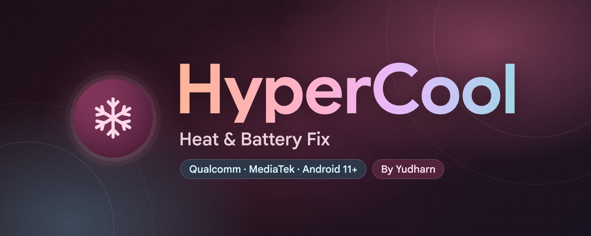

KernelSU / Magisk module for Qualcomm and MediaTek phones. Less heat, less battery drain, longer battery life.
Focused on battery life, not peak performance.

  
  
  
  

Everything is configured via WebUI and applied on the next boot. Only lightweight keepers run in the background, and only when enabled.

## Screenshots

<table align="center">
  <tr>
    <td align="center" valign="top">
      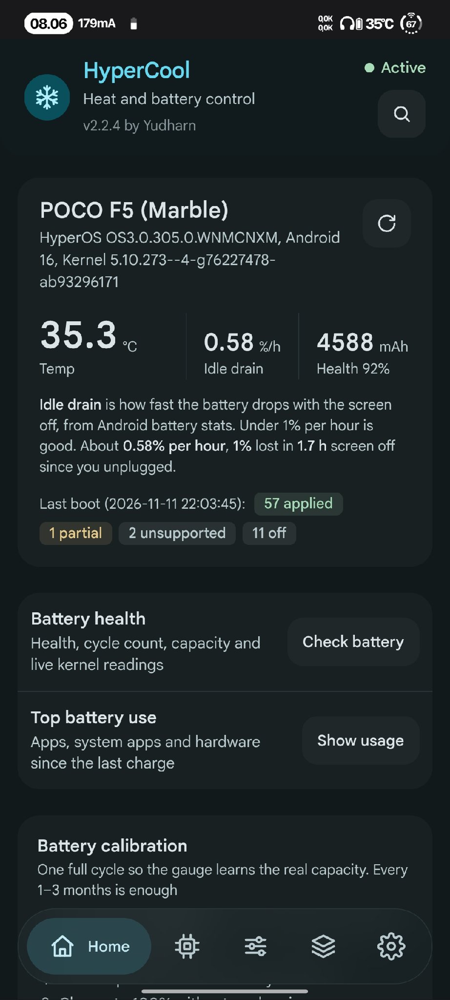 
      <b>Home</b>
    </td>
    <td align="center" valign="top">
      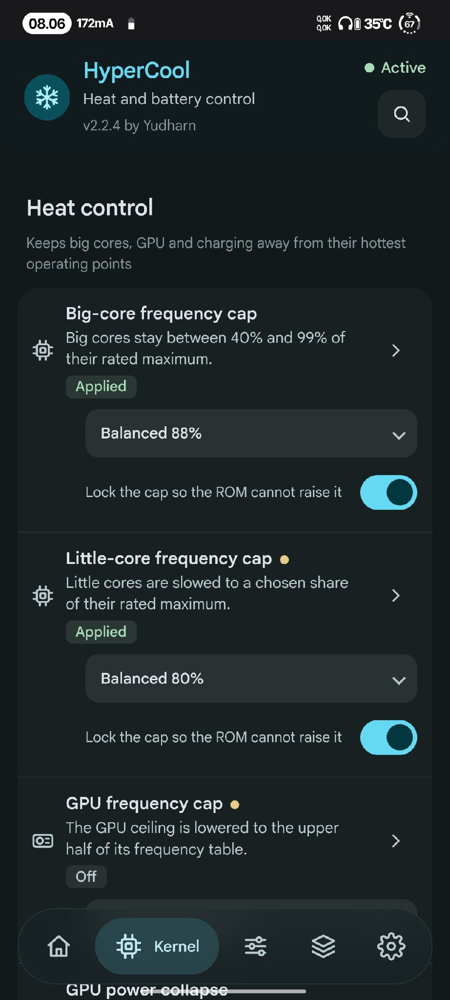 
      <b>Heat control</b>
    </td>
    <td align="center" valign="top">
      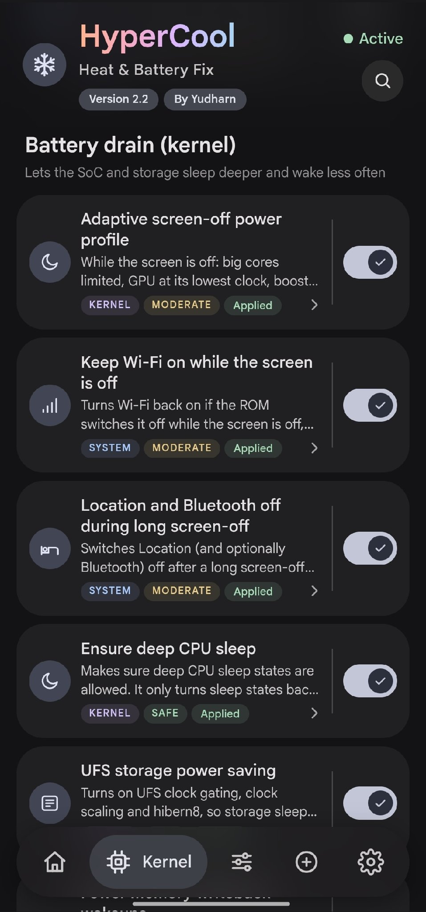 
      <b>Battery drain (kernel)</b>
    </td>
  </tr>
  <tr>
    <td align="center" valign="top">
      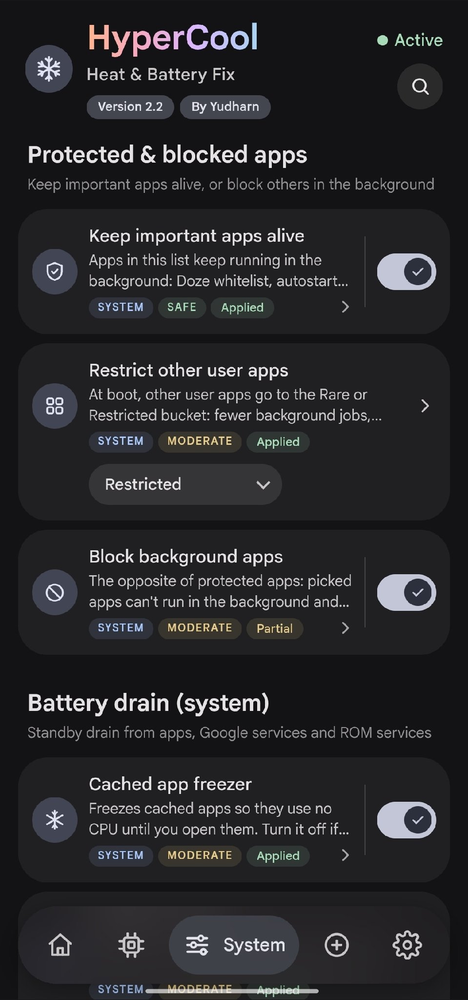 
      <b>Protected apps</b>
    </td>
    <td align="center" valign="top">
      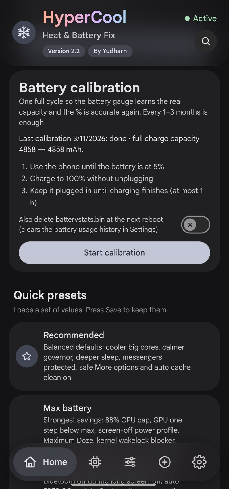 
      <b>Battery calibration</b>
    </td>
    <td align="center" valign="top">
      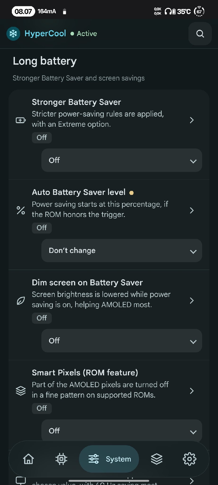 
      <b>Long battery</b>
    </td>
  </tr>
  <tr>
    <td align="center" valign="top">
      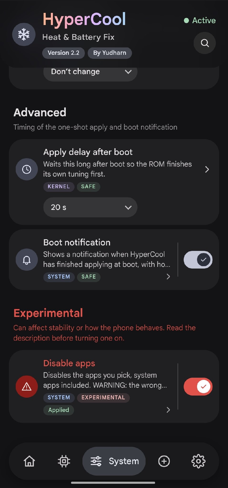 
      <b>Advanced</b>
    </td>
    <td align="center" valign="top">
      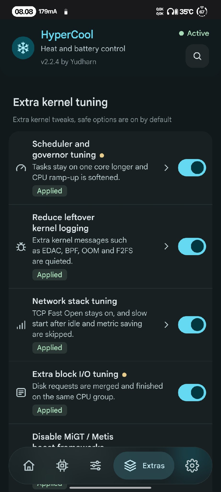 
      <b>Extra kernel tuning</b>
    </td>
    <td align="center" valign="top">
      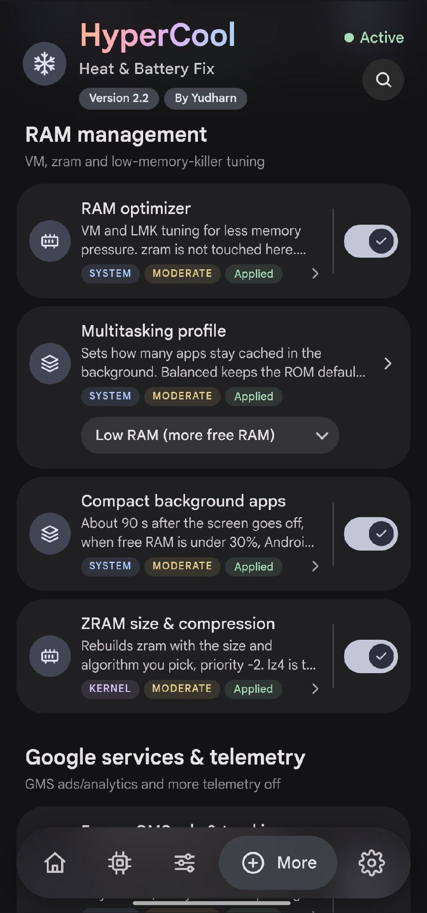 
      <b>RAM management</b>
    </td>
  </tr>
  <tr>
    <td align="center" valign="top">
      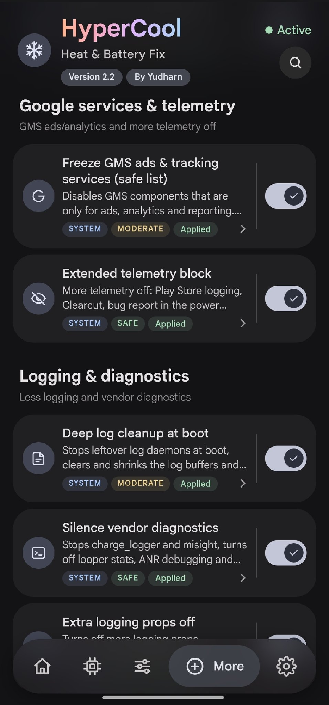 
      <b>Google services</b>
    </td>
    <td align="center" valign="top">
      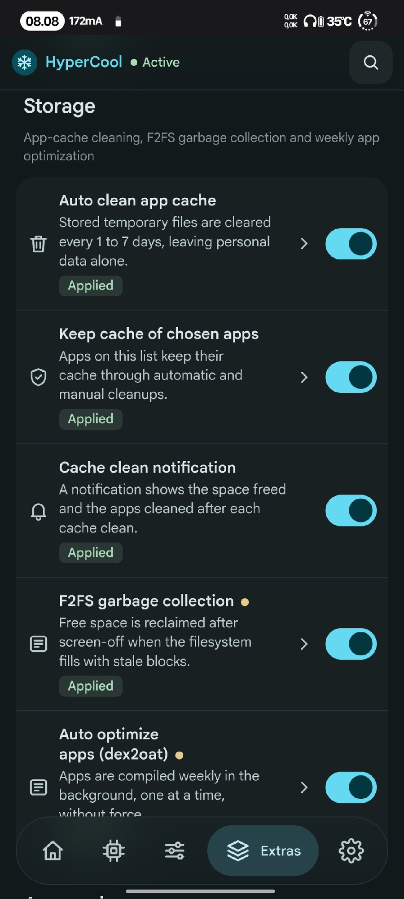 
      <b>Storage</b>
    </td>
    <td align="center" valign="top">
      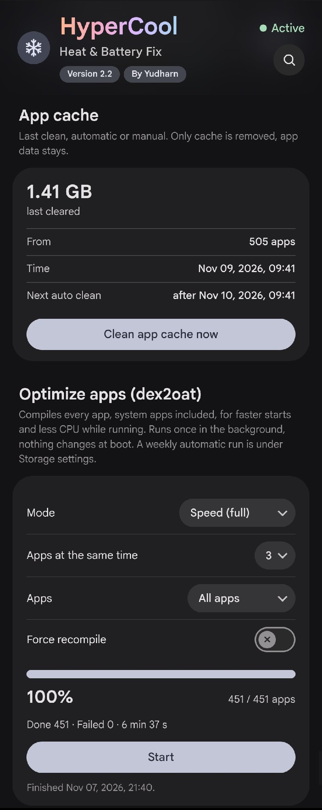 
      <b>App cache</b>
    </td>
  </tr>
  <tr>
    <td align="center" valign="top">
      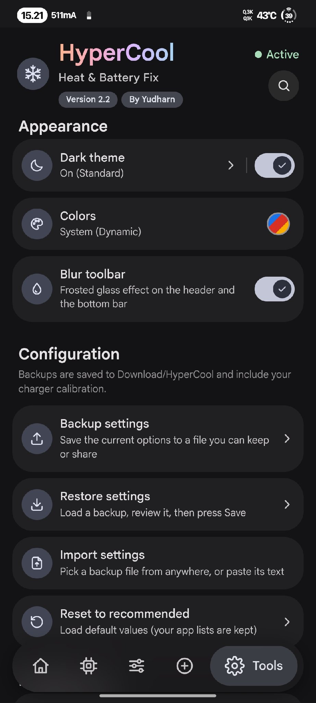 
      <b>Tools</b>
    </td>
    <td align="center" valign="top">
      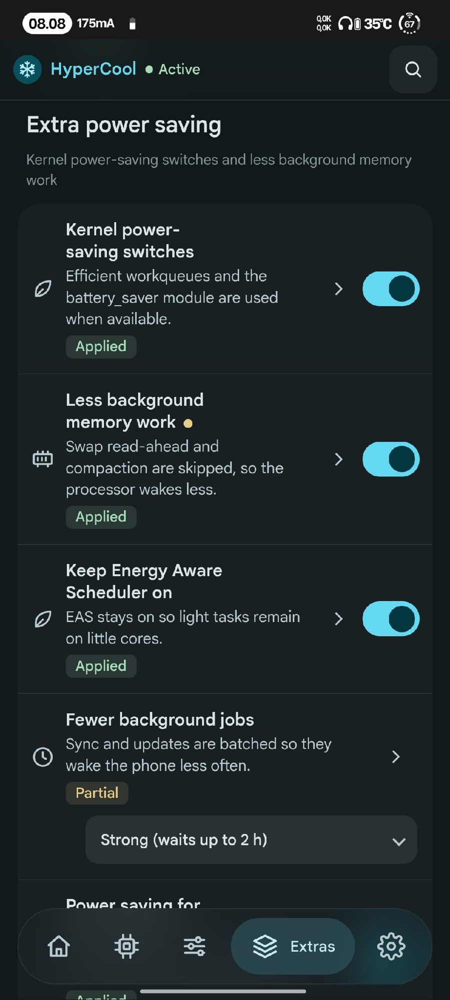 
      <b>Extra power saving</b>
    </td>
    <td align="center" valign="top">
      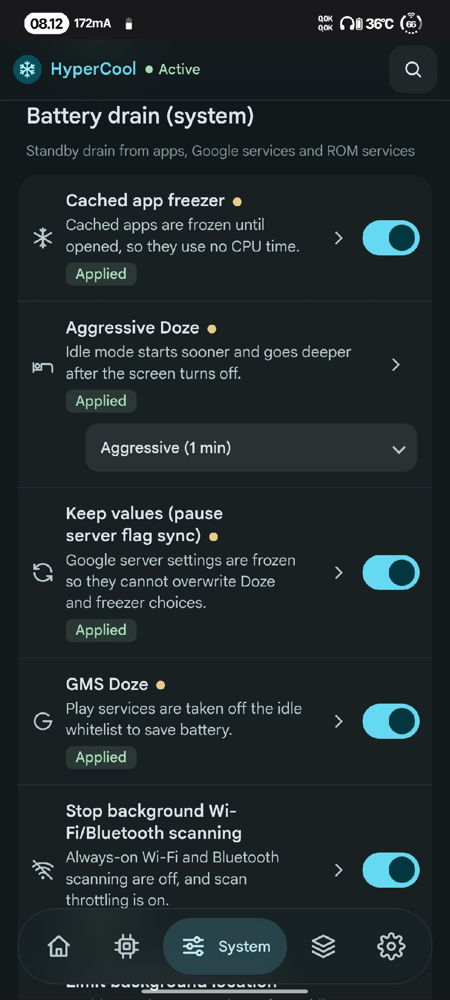 
      <b>Battery drain (system)</b>
    </td>
  </tr>
</table>

## Features
`Every feature has its own switch in the WebUI. Changes apply at boot; turning a feature off (or uninstalling) restores the original values. Unsupported features are skipped.`

**Heat control**
- Big / little core, GPU and memory bus frequency caps (with lock), GPU power collapse
- Calmer CPU governor (WALT / schedutil), kernel touch boost off
- Background apps on little cores, prime core parking (Qualcomm)
- CPU keeper: puts the caps back when the ROM undoes them
- UI blur off and cooler charging
- Heat guard (experimental): lower refresh rate and big-core limit while the battery is hot
- Pause / bypass charging when hot, at a level or while gaming (charging switch, 0 mA current limit or charger input off; Qualcomm and MediaTek), battery temperature warning
- Game battery mode: Android Game Mode with a 60 FPS cap and lower render resolution for games

**Battery drain (kernel)**
- Adaptive screen-off power profile, deep CPU sleep, UFS power saving
- Fewer writeback wakeups, kernel debug off, kernel wakelock blocker
- Screen-off: keep Wi-Fi on, Location / Bluetooth off, mobile data / NFC off (back on at screen-on)
- Hibernate background apps a few minutes after the screen goes off (Protected, default and in-use apps are skipped), plus Hibernate apps now on Home
- Screen-off drain check: drain per screen-off, alert when high, and the app that kept the phone awake
- F2FS cleanup and app optimization (dex2oat) once a week with the screen off
- Battery history: 48 h chart of level, temperature and screen-on / screen-off drain

**Apps**
- Keep important apps alive, restrict other user apps
- Block apps in background, disable apps

**Battery drain (system)**
- Cached app freezer, aggressive Doze, GMS Doze, App Standby
- Wi-Fi / BT scanning off, limited background location, network standby saving
- Less stats, logging and telemetry; analytics, ad packages and Joyose off

**Long battery**
- Stronger Battery Saver with auto level, screen dimming, Smart Pixels
- Refresh rate cap, adaptive refresh rate, animation scale, lower screen resolution

**Extras**
- Scheduler, I/O and common kernel tuning, balanced system defaults, MiGT / Metis off
- Faster network connections (TCP / BBR; for speed, not battery)
- RAM optimizer, multitasking profile, ZRAM size and compression
- GMS ads / analytics freeze, log cleanup, vendor diagnostics off
- Kernel power saving, Energy Aware Scheduler (C-state aware), idle USB / I2C / SPI power saving
- Fewer background jobs, compact background apps when RAM is low
- Auto app cache clean, on-demand app optimization, leftover app folder cleanup, boot notification

**Home**
- Search, Recent activity and Keeper status
- Idle drain, battery check, battery history and battery calibration
- Top battery use, Wake sources (with the apps holding wake locks), CPU use now

## Requirements
- Android 11+
- KernelSU, KernelSU Next or APatch (Magisk: open the WebUI with MMRL or KsuWebUI)
- Qualcomm or MediaTek SoC, any ROM

## Files
- `/data/adb/hypercool/config.conf` settings
- `/data/adb/hypercool/status.conf` last boot result
- `/data/adb/hypercool/boot.log` log
- `sh /data/adb/hypercool/restore.sh --all` restore every system change by hand

## Credits
- Frosty by Drsexo
- Power Saver Pro by @ShastikXD & @TempMeow (some code by @kveld9)
- Hyper Optimize by Tatsh
- Xtreme Battery Saver (DethByte64), Universal GMS Doze, sysconfig-patcher
- WebUI Mono theme: design inspired by Duck ToolBox by Eltavine (MIT)
- WebUI reference: Specter by @dpejoh1

## Support

> [!NOTE]
> If HyperCool is useful to you, consider supporting development:
>
> 

Other ways to support: [SociaBuzz](https://sociabuzz.com/yudharn) · [QRIS](https://t.me/ArchivesModules/1476)

## Disclaimer
HyperCool changes kernel and system settings. Use it at your own risk; the author is not responsible
for bootloops, data loss or damage. Make a backup first, and turn features off one by one if something
misbehaves. Provided without any warranty (see the GPL).

## License
GPL-3.0-or-later. Copyright (C) 2026 Yudharn. See [LICENSE](LICENSE).
Modified versions must stay GPL-3.0, keep the source open and keep this copyright notice.
Google Sans font: SIL Open Font License (`webroot/GoogleSans-OFL.txt`).
