# HyperCool - Heat & Battery Fix

KernelSU / Magisk module for Qualcomm and MediaTek phones. Less heat, less battery drain, longer battery life.
Focused on battery life, not peak performance.

  
  
  
  

Everything is set from the WebUI and applied once at the next boot. Nothing keeps running except
small keepers (charge limit, screen-off keeper that also serves Keep Wi-Fi on, Compact background apps, Location and Bluetooth off, F2FS garbage collection and auto app optimization, auto cache clean, CPU keeper, adaptive refresh rate, battery calibration), and only if you turn them on.

`Every feature has its own ON/OFF switch in the WebUI, changes apply once at boot, and turning a feature off (or uninstalling) puts the original values back`

## Screenshots

<table align="center">
  <tr>
    <td align="center" valign="top">
      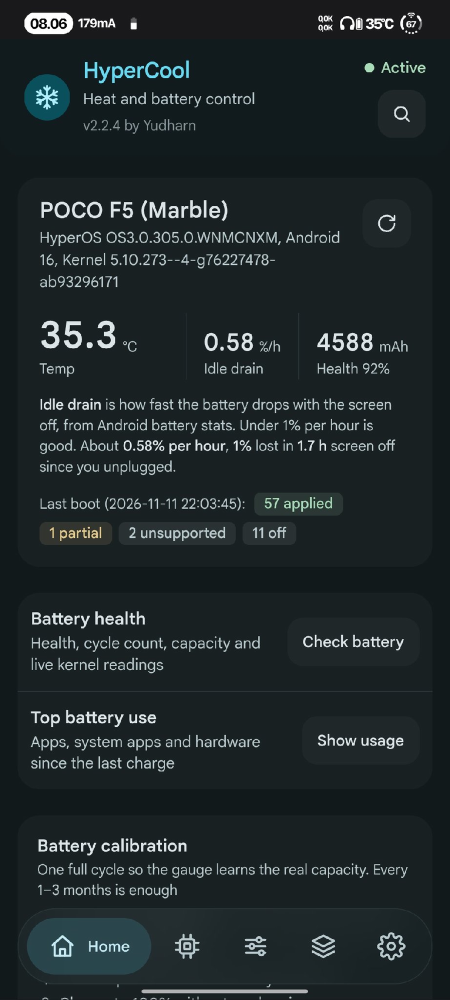 
      <b>Home</b>
    </td>
    <td align="center" valign="top">
      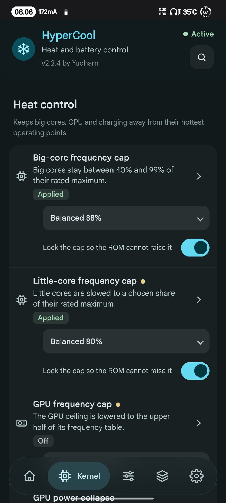 
      <b>Heat control</b>
    </td>
    <td align="center" valign="top">
      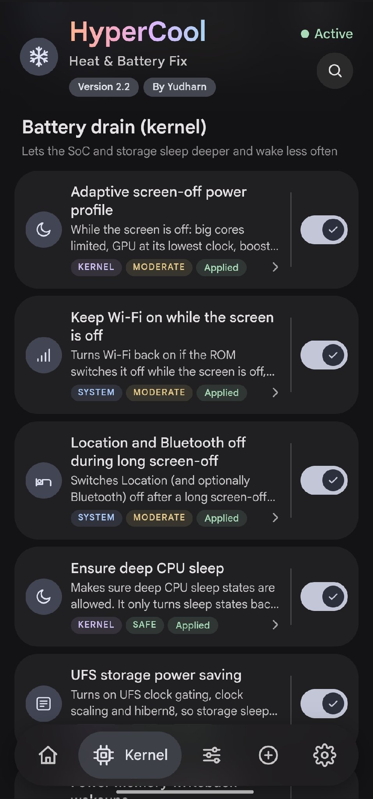 
      <b>Battery drain (kernel)</b>
    </td>
  </tr>
  <tr>
    <td align="center" valign="top">
      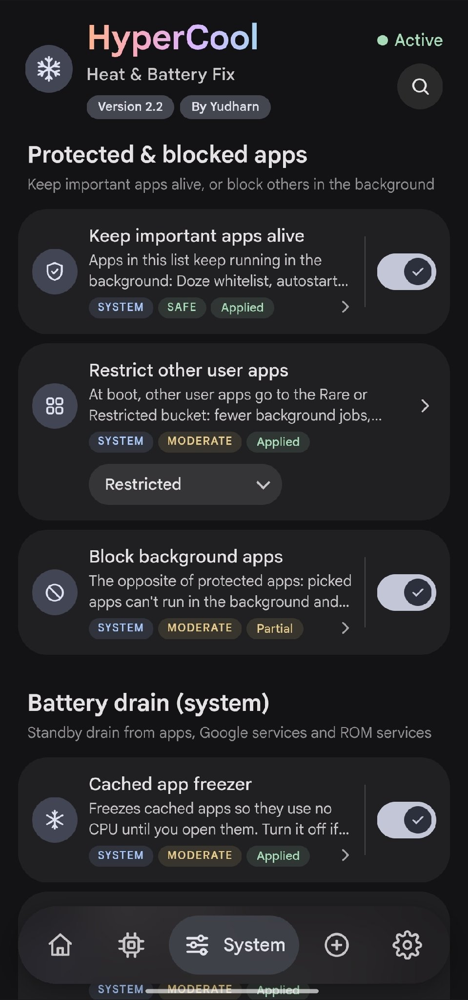 
      <b>Protected apps</b>
    </td>
    <td align="center" valign="top">
      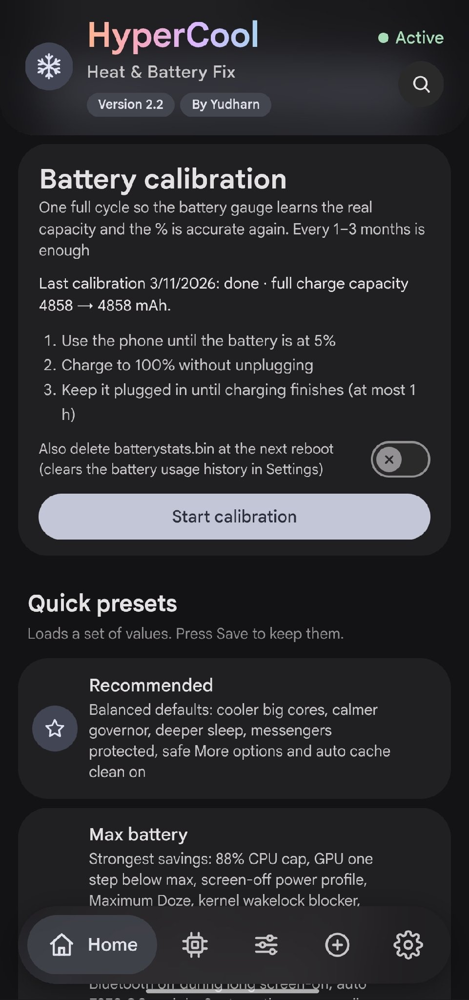 
      <b>Battery calibration</b>
    </td>
    <td align="center" valign="top">
      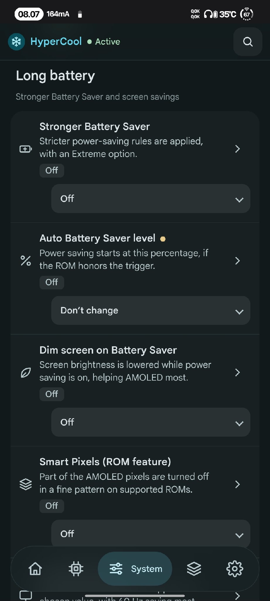 
      <b>Long battery</b>
    </td>
  </tr>
  <tr>
    <td align="center" valign="top">
      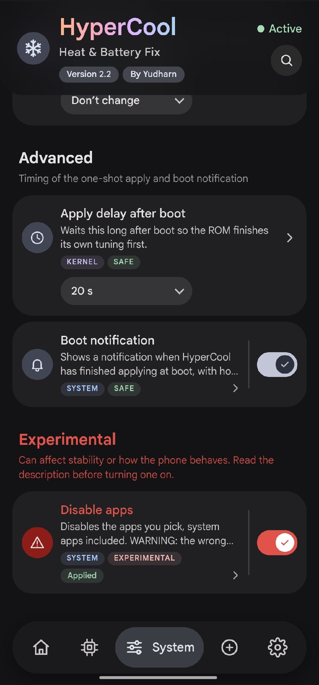 
      <b>Advanced</b>
    </td>
    <td align="center" valign="top">
      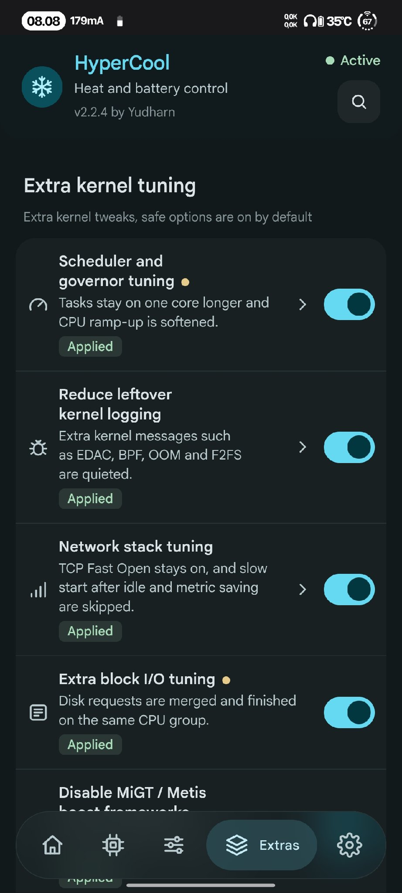 
      <b>Extra kernel tuning</b>
    </td>
    <td align="center" valign="top">
      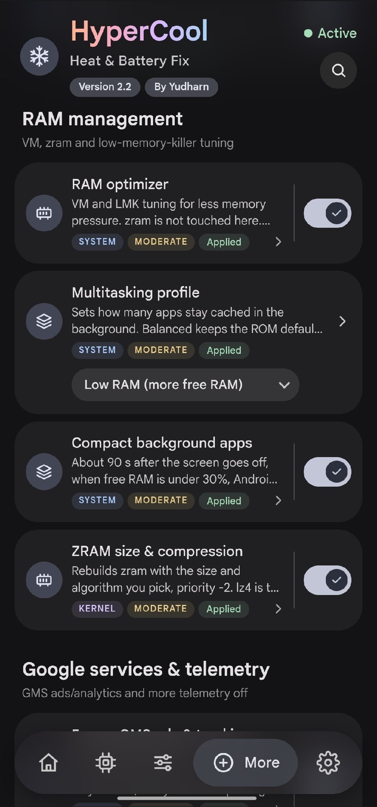 
      <b>RAM management</b>
    </td>
  </tr>
  <tr>
    <td align="center" valign="top">
      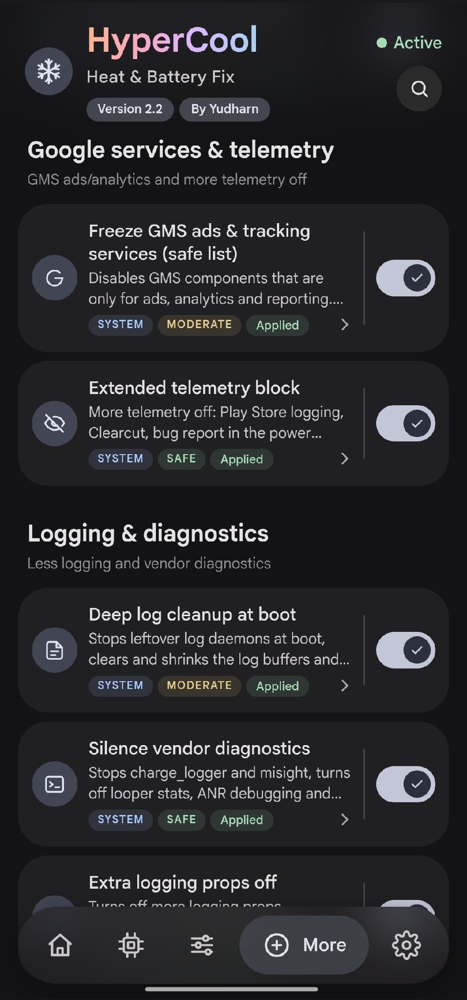 
      <b>Google services</b>
    </td>
    <td align="center" valign="top">
      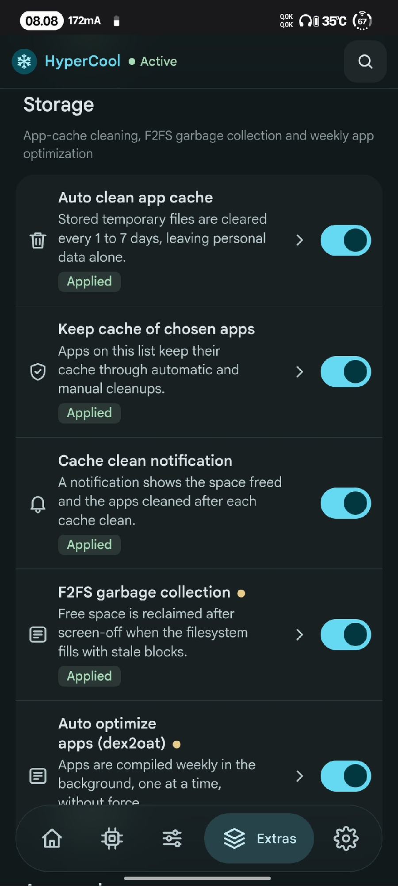 
      <b>Storage</b>
    </td>
    <td align="center" valign="top">
      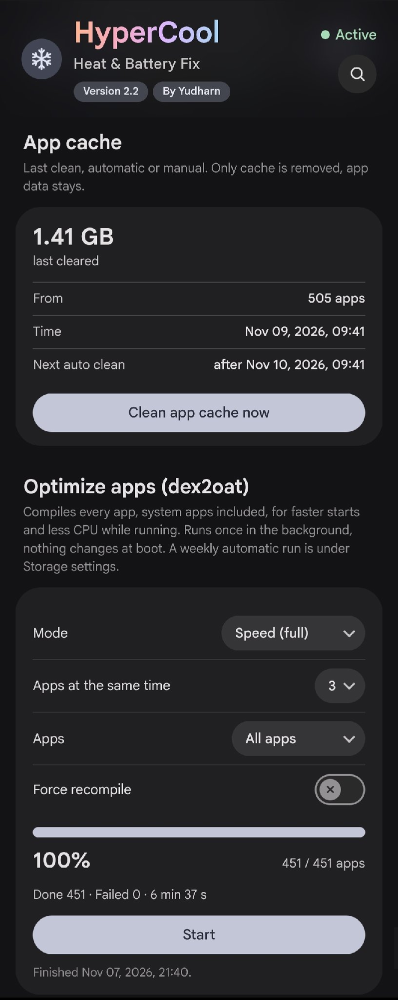 
      <b>App cache</b>
    </td>
  </tr>
  <tr>
    <td align="center" valign="top">
      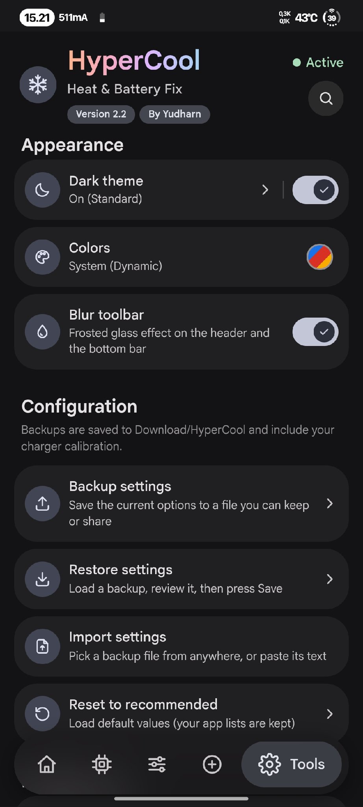 
      <b>Tools</b>
    </td>
    <td align="center" valign="top">
      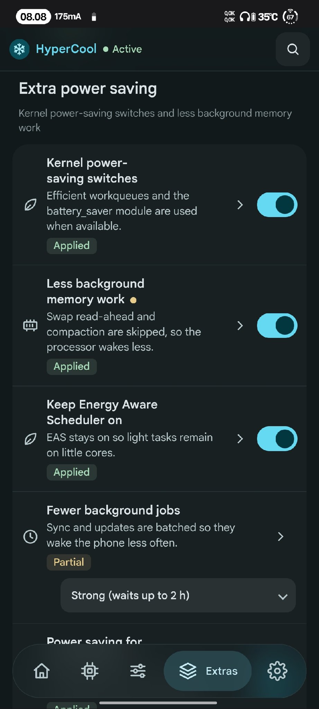 
      <b>Extra power saving</b>
    </td>
    <td align="center" valign="top">
      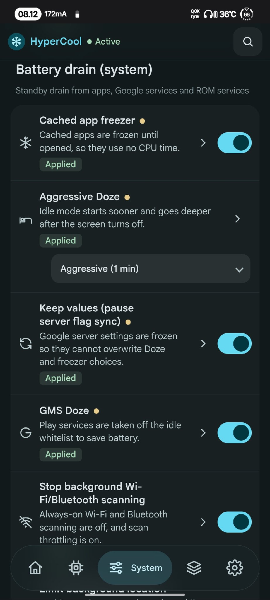 
      <b>Battery drain (system)</b>
    </td>
  </tr>
</table>

## Features

**Heat control**
- Big-core frequency cap (with lock)
- Little-core frequency cap (default off, with lock)
- GPU frequency cap (from your own GPU table, with lock)
- GPU power collapse
- Less aggressive CPU governor (WALT / schedutil)
- Disable kernel touch boost
- Background apps on little cores
- Park prime core (Qualcomm; switches core_ctl on when the kernel has it off, checks that the core is really parked, locks the nodes)
- CPU keeper: keeps the big/little caps and the prime parking in place when the ROM undoes them
- Disable UI blur
- Cooler charging (current limit) and charge limit ~80% (Xiaomi)

**Battery drain (kernel)**
- Adaptive screen-off power profile
- Deep CPU sleep, UFS power saving
- Fewer writeback wakeups, less I/O accounting
- Turn off kernel debug, kernel wakelock blocker
- Keep Wi-Fi on while the screen is off (turns it on again when the ROM switches it off; Wi-Fi you switch off yourself stays off)
- Location and Bluetooth off after a long screen-off (both come back when the screen turns on; off by default)
- F2FS garbage collection with the screen off (Storage; frees space that only GC can give back; once a week at most, no charger needed; off by default)
- Auto optimize apps (dex2oat) once a week with the screen off (Storage; speed-profile, no force recompile, result as a notification; off by default)
- Top battery use (Home; read only: user apps, system apps, system services and hardware, from Android battery stats)

**Apps**
- Keep important apps alive
- Restrict other user apps
- Block apps in background
- Disable apps (pick with care)

**Battery drain (system)**
- Cached app freezer, aggressive Doze, GMS Doze
- Wi-Fi/BT scanning off, limit background location, network standby saving
- App Standby, less stats, telemetry off
- Disable analytics & ad packages, Joyose off, less logging

**Long battery**
- Stronger Battery Saver, auto saver level
- Dim screen on Battery Saver, Smart Pixels (ROMs that have it)
- Refresh rate cap, adaptive refresh rate (high on touch, low when idle), animation scale

**Extras**
- Scheduler, network and I/O tuning
- MiGT / Metis off (Xiaomi)
- Balanced system defaults, common kernel tuning
- RAM optimizer, multitasking profile
- ZRAM size & compression (2-8 GB or custom up to 12 GB)
- GMS ads/analytics freeze, more telemetry off
- Log cleanup, vendor diagnostics off
- Kernel power-saving switches, Energy Aware Scheduler
- Power saving for idle USB / I2C / SPI devices (opt-in)
- Fewer background jobs: JobScheduler batches background work for 1-2 hours (Balanced / Strong, read back and put back if the ROM ignores it)
- Compact background apps: compacts the memory of background apps after the screen has been off, only when free RAM is low
- Auto clean app cache (every 1 to 7 days), apps that keep their cache, cache clean notification
- Optimize apps (dex2oat) for all apps with live progress (Extras tab, on demand)
- Boot notification when everything is applied

**Home**
- Search: find any feature by name and jump to it
- Idle drain: battery drop per hour with the screen off since the last unplug (shows after a 1% drop)
- Battery check: health, capacity, cycle count, temperature and more
- Battery calibration: guided full cycle (5% → 100% → until charging finishes) so the battery % is accurate (optionally deletes batterystats.bin)

Every feature shows what it changes and the result of the last boot.
Turning a feature off puts the original value back. Unsupported features are skipped.

## Requirements
- Android 11+
- KernelSU, KernelSU Next or APatch (Magisk: open the WebUI with MMRL or KsuWebUI)
- Qualcomm or MediaTek SoC, any ROM

## Files
- `/data/adb/hypercool/config.conf` settings
- `/data/adb/hypercool/status.conf` last boot result
- `/data/adb/hypercool/boot.log` log
- `sh /data/adb/hypercool/restore.sh --all` restore every system change by hand

## Credits
- Frosty by Drsexo
- Power Saver Pro by @ShastikXD & @TempMeow (some code by @kveld9)
- Hyper Optimize by Tatsh
- Xtreme Battery Saver (DethByte64), Universal GMS Doze, sysconfig-patcher

## Support
- SociaBuzz: https://sociabuzz.com/yudharn
- PayPal (Ko-fi): https://ko-fi.com/yudharn
- QRIS: https://t.me/ArchivesModules/1476

Telegram: https://t.me/ModuleArchives

## Disclaimer
HyperCool changes kernel and system settings. Use it at your own risk; the author is not responsible
for bootloops, data loss or damage. Make a backup first, and turn features off one by one if something
misbehaves. Provided without any warranty (see the GPL).

## License
GPL-3.0-or-later. Copyright (C) 2026 Yudharn. See [LICENSE](LICENSE).
Modified versions must stay GPL-3.0, keep the source open and keep this copyright notice.
Google Sans font: SIL Open Font License (`webroot/GoogleSans-OFL.txt`).
