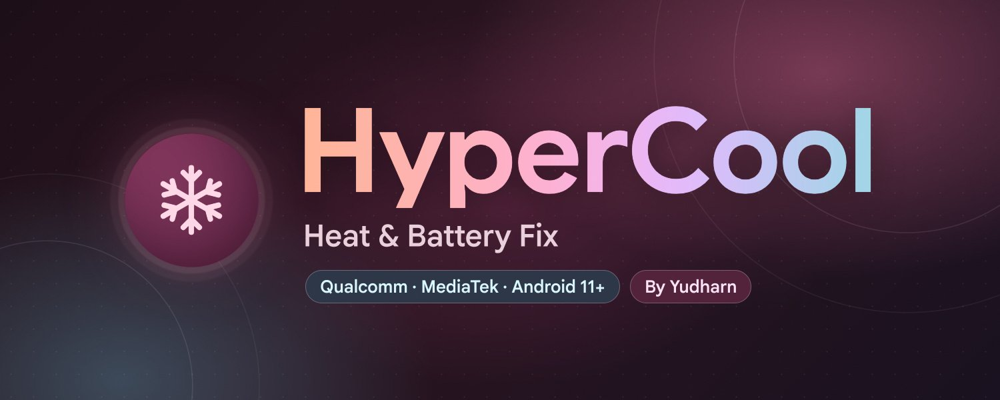

# HyperCool - Heat & Battery Fix

KernelSU / Magisk module for Qualcomm and MediaTek phones. Less heat, less battery drain, longer battery life.
Focused on battery life, not peak performance.

Everything is set from the WebUI and applied once at the next boot. Nothing keeps running except
small keepers (charge limit, charge hold, screen-off keeper that also serves Keep Wi-Fi on, Compact background apps, Location and Bluetooth off, F2FS garbage collection and auto app optimization, auto cache clean, CPU keeper, adaptive refresh rate, battery calibration), and only if you turn them on.

## Features

**Heat control**
- Big-core frequency cap (with lock)
- Little-core frequency cap (default off, with lock)
- GPU frequency cap (from your own GPU table, with lock)
- GPU power collapse
- Calmer CPU governor (WALT / schedutil)
- Disable kernel touch boost
- Background apps on little cores
- Park prime core (Qualcomm; switches core_ctl on when the kernel has it off, checks that the core is really parked, locks the nodes)
- CPU keeper: keeps the big/little caps and the prime parking in place when the ROM undoes them
- Disable UI blur
- Cooler charging (current limit) and charge limit ~80% (Xiaomi)

**Battery drain (kernel)**
- Adaptive screen-off power profile
- Deep CPU sleep, UFS power saving
- Fewer writeback wakeups, lighter I/O accounting
- Silence kernel debug, kernel wakelock blocker
- Keep Wi-Fi on while the screen is off (turns it on again when the ROM switches it off; Wi-Fi you switch off yourself stays off)
- Location and Bluetooth off after a long screen-off (both come back when the screen turns on; off by default)
- F2FS garbage collection with the screen off (Storage; frees space that only GC can give back; once a week at most, no charger needed; off by default)
- Auto optimize apps (dex2oat) once a week with the screen off (Storage; speed-profile, no force recompile, result as a notification; off by default)
- Top battery use (Home; read only: user apps, system apps, system services and hardware, from Android battery stats)

**Apps**
- Keep important apps alive
- Restrict other user apps
- Block apps in background
- Disable apps (pick with care)

**Battery drain (system)**
- Cached app freezer, aggressive Doze, GMS Doze
- Wi-Fi/BT scanning off, limit background location, network standby saving
- App Standby, less stats, telemetry off
- Disable analytics & ad packages, Joyose off, less logging

**Long battery**
- Stronger Battery Saver, auto saver level
- Dim screen on Battery Saver, Smart Pixels (ROMs that have it)
- Refresh rate cap, adaptive refresh rate (high on touch, low when idle), animation scale

**More**
- Scheduler, network and I/O tuning
- MiGT / Metis off (Xiaomi)
- Balanced system defaults, common kernel tuning
- RAM optimizer, multitasking profile
- ZRAM size & compression (2-8 GB or custom up to 12 GB)
- GMS ads/analytics freeze, more telemetry off
- Log cleanup, vendor diagnostics off
- Kernel power-saving switches, Energy Aware Scheduler
- Runtime power for idle USB / I2C / SPI devices (opt-in)
- Fewer background jobs: JobScheduler batches background work for 1-2 hours (Balanced / Strong, read back and put back if the ROM ignores it)
- Compact background apps: compacts the memory of background apps after the screen has been off, only when free RAM is low
- Auto clean app cache (every 1 to 7 days), apps that keep their cache, cache clean notification
- Optimize apps (dex2oat) for all apps with live progress (More tab, on demand)
- Boot notification when everything is applied

**Home**
- Search: find any feature by name and jump to it
- Idle drain: battery drop per hour with the screen off since the last unplug (shows after a 1% drop)
- Battery check: health, capacity, cycle count, temperature and more
- Battery calibration: guided full cycle (5% → 100% → until charging finishes) so the battery % is accurate (optionally deletes batterystats.bin)

Every feature shows what it changes and the result of the last boot.
Turning a feature off puts the original value back. Unsupported features are skipped.

## Requirements
- Android 11+
- KernelSU, KernelSU Next or APatch (Magisk: open the WebUI with MMRL or KsuWebUI)
- Qualcomm or MediaTek SoC, any ROM

## Files
- `/data/adb/hypercool/config.conf` settings
- `/data/adb/hypercool/status.conf` last boot result
- `/data/adb/hypercool/boot.log` log
- `sh /data/adb/hypercool/restore.sh --all` restore every system change by hand

## Credits
- Frosty by Drsexo
- Power Saver Pro by @ShastikXD & @TempMeow (some code by @kveld9)
- Hyper Optimize by Tatsh
- Xtreme Battery Saver (DethByte64), Universal GMS Doze, sysconfig-patcher
- Specter by @dpejoh1 for the WebUI style, the Appearance settings (dark theme, dynamic colors) and the dynamic color method

## Support
- SociaBuzz: https://sociabuzz.com/yudharn
- PayPal (Ko-fi): https://ko-fi.com/yudharn
- QRIS: https://t.me/ArchivesModules/1476

Telegram: https://t.me/ModuleArchives

## Disclaimer
HyperCool changes kernel and system settings. Use it at your own risk; the author is not responsible
for bootloops, data loss or damage. Make a backup first, and turn features off one by one if something
misbehaves. Provided without any warranty (see the GPL).

## License
GPL-3.0-or-later. Copyright (C) 2026 Yudharn. See [LICENSE](LICENSE).
Modified versions must stay GPL-3.0, keep the source open and keep this copyright notice.
Google Sans font: SIL Open Font License (`webroot/GoogleSans-OFL.txt`).

## Changelog

**v2.1.1**
- Fixed: the RAM optimizer no longer disables Xiaomi's perfmgr (`perfmgr_enable`). It is a GPU/frame boost framework, not memory reclaim: it added no RAM, was not restored when switched off, and was the only perfmgr parameter HyperCool changed. The VM, LMK and other vendor reclaim writes stay.

**v2.1**
- New: WebUI redesign: dark violet palette, separate rounded cards, flat top bar, floating bottom navigation with a tonal active tab
- New: Appearance in Tools: Dark theme (Standard, AMOLED, Light, Follow system) and Colors (System Dynamic from the wallpaper, HyperCool Violet, 9 color presets)
- Changed: the HyperCool title in the header keeps its color gradient, as in v2.0.1
- New: Experimental features are collected in a red "Experimental" zone at the bottom of their page (red title, red icons and switches)
- Changed: the labels KERNEL, SYSTEM, XIAOMI, SAFE, MODERATE, EXPERIMENTAL and the status labels (Applied, Partial, Failed) are now soft tonal pills instead of bright outlines
- Fixed: false "Applied" status. Protected apps and Block background apps now check that the background permission really changed; Debloat, Disable apps and Joyose count an app only if it is really disabled; GMS Doze, Smart Pixels and Adaptive refresh rate show Partial or Failed when they could not be confirmed; log and debug props show Failed when no prop was accepted
- Changed: Quick presets Max battery and Cool gaming now also switch on auto F2FS GC, auto dex2oat and runtime power (Max battery also fewer background jobs and Location/Bluetooth off during long screen-off). Keep Wi-Fi on, Charge limit, Adaptive refresh rate, ZRAM, Multitasking and Compact background apps are left as you set them when a preset does not mention them
- New: Appearance > Blur toolbar (on by default): frosted glass effect on the header and the bottom bar
- Changed: the header has rounded bottom corners, and the bottom bar no longer has an outline
- Banner unchanged

**v2.0.1**
- Fix: Keep Wi-Fi on while the screen is off no longer turns Wi-Fi back on while the screen is on (a screen event replayed at start, or a panel brightness node that stays 0). It only acts when the power service says the screen is really off
- Fix: Compact background apps now recognises Android's real output ("Finished some compaction") and reports the done/failed count correctly
- Fix: Location and Bluetooth off during long screen-off now uses `cmd bluetooth_manager` on Android 13+, where `svc bluetooth` no longer exists

**v2.0**
- New: Auto clean app cache every 1 to 7 days (was daily only)
- New: Keep cache of chosen apps (skipped by the auto clean and Clean now; good for games so they do not load shaders again)
- New: CPU keeper. When a big-core cap, a little-core cap or Park prime core is on, a tiny keeper checks every 30 s (only while the phone is awake) and puts them back if the ROM undid them. It gives up for 10 minutes if the ROM undoes them 5 times in 10 minutes. No new setting
- Fix: Park prime core no longer stops at "core_ctl is disabled": it switches core_ctl on for that cluster until the next reboot, checks that the core is really parked (reports Unsupported otherwise) and locks the core_ctl nodes so the ROM cannot undo it
- New: Little-core frequency cap (50-99%, default off, with its own Lock switch)
- New: Optimize apps (dex2oat) in More: compiles all apps, system apps included, with progress in percent, app count and the names being compiled. Modes Speed (default), Speed-profile, Everything, Reset to default. Optimize all apps or only the apps you pick. Pauses at 48°C battery (continues at 47°C), stops at 15% battery without charger or under 1 GB free storage. Runs once, nothing changes at boot
- Fix: Park prime core status now reads "parked (paused via core_ctl, stays online at minimum frequency N MHz)".
- New: Fewer background jobs (More > Extra power saving, Off / Balanced / Strong): JobScheduler waits for more jobs and up to 1-2 hours, so background work runs in fewer batches. Only the settings this Android lists in dumpsys jobscheduler are written, and they are read back; if not taken they are put back and it says Unsupported.
- New: Compact background apps (More > RAM, off by default): about 90 s after the screen goes off, when free RAM is under 30%, background apps get their memory compacted (cmd activity compact, not closed), at most every 20 min. Runs in the screen-off keeper (no extra process) and stops when the screen turns on. Frees RAM, does not save battery.
- New: Keep Wi-Fi on while the screen is off (Battery drain, off by default): if the ROM switches Wi-Fi off with the screen off, it is turned on again, seen at once through Wi-Fi link events (plus a 60 s timer). Wi-Fi you switch off yourself stays off. Shares the screen-off keeper.
- New: Location and Bluetooth off during long screen-off (Battery drain, off by default): after the screen has been off for 5 to 120 min (default 15), Location is switched off and comes back right when the screen turns on. Bluetooth can be switched off the same way (extra option; skipped while audio plays or an audio device is connected, best effort). Location alarms, Find My Device and navigation with the screen off get no position meanwhile. Runs in the same screen-off keeper, nothing is polled.
- New: Safe mode. If three boots in a row do not finish, HyperCool switches itself off for the next boot (the module description says so) and the ROM stays as it is; turn it on again in the manager when you want.
- New: F2FS garbage collection (More > Storage, off by default): when the screen has been off 10 min and the reclaimable space (F2FS "unusable") is at least 1 to 15 GB (default 4), it runs the same gc_urgent garbage collection as Android idle maintenance for up to 7 min, at most once a week. No charger needed (30% battery when not charging); battery under 40 C to start, stops at 45 C (adjustable), under 20% battery or when the screen turns on. Optional weekly fstrim; a notification shows the result; pauses 7 days if two runs free almost nothing. Needs /data on F2FS with the gc_urgent node. Not tested on a device yet.
- New: Auto optimize apps (More > Storage, off by default): once a week, after the screen has been off 10 min, all apps (system apps included) are compiled in the background with the same script as the Optimize apps card: mode of your choice (speed-profile by default, or speed / everything), one app at a time, never a force recompile (apps that are already optimized are skipped). No charger needed (40% battery when not charging); starts under 40 C, stops at 45 C, under 15% battery, under 1 GB free storage or when the screen turns on (the apps now compiling finish). A run you start by hand counts as this week's run and is never stopped by it. Notification with the result (can be turned off). Runs in the screen-off keeper.
- New: Top battery use (Home): shows which apps and system parts used the most battery since the last charge, with filters for user apps, system apps and hardware. Read only; uses `dumpsys batterystats` (mAh estimate) and falls back to wake lock time when the ROM has no estimate.
- Change: Home shows Battery health in mAh (full-charge capacity, with the % of design capacity) instead of the battery level, and the device name is bigger, bold, with a capital codename (POCO F5 (Marble)).

**v1.9**
- New: Adaptive refresh rate (high rate only while touching / pressing a button, low rate 2 s after the last touch; screen changes stay at the low rate, HyperOS supported)
- New: Limit background location (1 / 2 / 4 h for apps in the background)
- New: Boot notification when HyperCool has finished applying
- New: Bug report in Tools (device info, last boot result, settings and boot log in one file)
- New: Runtime power for idle devices (USB / I2C / SPI power down when idle, touch / audio / charger chips skipped, default off)
- New: Custom quick preset (save your own settings, load them with one tap)
- New: Battery calibration on Home (guided full cycle with notifications, Charge limit pauses, optional batterystats.bin delete)
- New: Cache clean notification (after the auto clean and after Clean now, can be turned off)
- WebUI: swipe left/right to change tabs, Support moved to Tools, smaller Battery check text
- Idle drain counts from the last unplug (like other battery apps) and resets while charging
- Refresh rate options list only the rates your screen supports
- Idle drain shows after a 1% drop with the screen off (was 2% and 1 h)
- Quick presets no longer change the notification switches
- Removed: Multi-Gen LRU option

**v1.8**
- New: ZRAM size (2-8 GB or custom up to 12 GB), compression algorithm, priority -2
- New: Dim screen on Battery Saver (90-60% brightness, Android's own Battery Saver setting)
- New: Smart Pixels switch for ROMs that have it (crDroid, Resurrection Remix...)
- Screen-off profile keeper waits for screen events instead of checking every 2-3 s; AOD now counts as screen off
- Balanced system defaults: touch/GPU boosts off (Qualcomm and MediaTek), new option to unlock bus/DDR limits (default off)
- New: feature search next to the module status
- Fix: ZRAM swapoff on ROMs that list zram as /dev/block/zram0
- Fix: ZRAM sizes above 2 GB
- ZRAM is set right after boot and checked again later in case the ROM changes it; works even when zram is already in use
- Fix: Screen-off profile could put back a temporary thermal CPU limit after the screen turned on
- Fix: screen-off keeper ran dumpsys every 2-3 s on phones without a backlight node (now every 10 s, only when screen events are missing)
- Fix: haptics/vibration stopped working on some devices (vibrator HAL no longer moved to the background group)
- Fix: Battery Saver no longer turns vibration off (silent mode, haptics); new switch in Stronger Battery Saver if you want it off
- Fix: Idle drain read too low on some ROMs; now uses the % drained with the screen off (or 1% screen-off steps), like other battery apps
- Description: "Device: Qualcomm | MediaTek", shorter text
- Shorter WebUI texts, README rewritten
- License: GPL-3.0-or-later

**v1.7**
- New: Disable apps
- New: Adaptive screen-off power profile
- New: GPU frequency cap with your own GPU table and lock
- New: Balanced system defaults, common kernel tuning, keep EAS on
- New: Idle drain and Battery check on Home
- Background apps on little cores can also move log daemons
- Calmer CPU governor: WALT task util 80/65
- Analytics & ad packages now a fixed list only
- Cache clean time in 24h format

**v1.6**
- MediaTek support for the kernel features
- Lock option for the big-core cap
- Support links, Telegram in About
- Disable guard: ROM changes restored when the module is disabled

**v1.5**
- Kernel power-saving switches, lighter background memory work
- Real chip name in the installer
- Live check for the big-core cap

**v1.4**
- Block apps in background
- Import backup (file or paste)
- Presets for every feature, safer defaults

**v1.3**
- Auto clean app cache (daily) with App cache card

**v1.2**
- Bug fixes: More lists on mksh, GMS Doze off by default, safer RAM and log options, uninstall fixes

**v1.1**
- New More tab with extra kernel, RAM, GMS and logging options
- Clean RAM now, clean junk files now

**v1.0**
- First release
